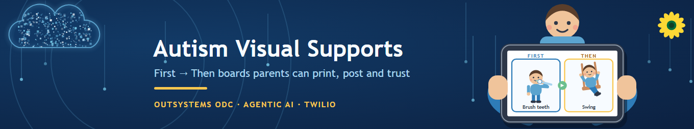

# Autism Visual Supports

**First → Then boards that parents can print, post, and trust.**

An OutSystems Developer Cloud application that turns two minutes of what a parent
already knows about their child into a printable, tappable visual support — and then
tracks the one thing that decides whether the child keeps trusting it.

Built for the [OutSystems Build for the Future Hackathon 2026](https://taikai.network/en/outsystems/hackathons/build-for-the-future-2026).



---

## The problem

Ask any parent of an autistic child about mornings and you hear the same story. The
child is on the floor with a toy. In four minutes they need shoes on with their go-bag
and they need to be in the car. "We have to go now" does not work, and saying it
louder works less.

What works is a picture. **First shoes. Then swing.**

The method is well established — the Vanderbilt Kennedy Center's TRIAD toolkit,
published through the Autism Speaks Autism Treatment Network, documents First–Then
boards, visual schedules and parameter cards as core practice. The problem is the
*making*: finding pictures the child recognises, cutting them to size, keeping every
label to three words, laminating, adding Velcro. That is a forty-minute craft project,
and the morning you needed it was this morning.

And there is a second failure, quieter and worse. The toolkit is blunt about it:

> "In order to teach children with ASD the value of the First-Then Board, you must
> give them the reinforcing activity or item after they complete the 'first' task.
> **Otherwise, your child may not trust the board the next time you use it.**"

A board the child has stopped trusting is worse than no board. The next one starts
from suspicion.

## What this builds

Three questions in — which routine, what is hard about it, what the child actually
wants afterwards — and three things out:

1. **The cards.** Three words maximum, phrased positively ("Walk in hallway", never
   "Don't run"), ready to print with cut lines or to use full-screen on a tablet.
2. **The caregiver script.** The one or two low-demand phrases to say out loud. Most
   tools stop at the picture; the words are what parents fumble.
3. **The implementation plan.** Where to put the board, the prompt hierarchy from
   least to most intrusive, and what to do when it goes wrong.

Then the part nobody else does: when the routine is due, the app **texts the parent
the script**, and afterwards asks one question — *did the reward actually happen?*
The reply is one character. That single field is the one the whole method depends on,
and the one no parent will ever open an app to fill in, because at that moment they
are at the front door holding a pair of shoes.

The home screen shows, per board, how reliably the promise has been kept — not how
many boards you have made.

## How it is built

| Layer | Choice |
|---|---|
| Application | OutSystems Developer Cloud (ODC) |
| AI | Three agents in Agent Workbench — **Composer**, **Reviewer**, **Illustrator** |
| Grounding | Vanderbilt TRIAD toolkit + the National Autism Center's 11 evidence-based practices |
| Models | Azure OpenAI / Amazon Bedrock, via the ODC instance |
| Messaging | Twilio SMS, for the script and the reward confirmation |

Guardrails are enforced in the application, not requested in a prompt: labels over
three words are rejected, a First–Then board cannot be saved without a Then card, and
when a parent describes self-injury or escalation the app surfaces referral guidance
instead of generating a board. A child's name never appears in an image prompt.

## Repository

```
docs/
  Autism-Visual-Supports-Overview.pdf    the project deck
  Autism-Visual-Supports-Overview.pptx   editable source of the deck
  Autism-Visual-Supports-Mid-Submission.pdf   the 4 November mid submission
  build-spec.html                        full build spec — data model, screens, agents
  project-description.md                 the project write-up
SPEC.md                                  the build spec in Markdown
MID-SUBMISSION.md                        problem, use case, AI services — due 4 Nov
prompts/                                 the three prompt drafts the pipeline came from
assets/                                  all artwork, plus the generator that draws it
  ASSETS.md                              palette, ratios, and the design cautions
  build_art.py                           regenerates every image from source
```

Every image in this repository is original vector art generated by
`assets/build_art.py` and rasterized with headless Chrome. Nothing is stock, so there
is no attribution or licensing obligation attached to any of it.

## Status

Pre-build. Registration closes 28 October 2026; the kickoff is 2 November and teams
have seven days. This repository currently holds the specification, the deck and the
artwork. The ODC application lands during the build window.

## Evidence base

- Vanderbilt Kennedy Center TRIAD / Autism Speaks ATN, *Visual Supports and Autism*
  (2011) — [Autism Speaks tool kit](https://www.autismspeaks.org/tool-kit/autism-care-networkair-p-visual-supports-and-autism)
- National Autism Center, *National Standards Report* (2009), as presented in
  *Supporting Athletes with Autism Through Professional Development for Coaches and
  Physical Educators*

Practitioner resources: [do2learn](https://www.do2learn.com) ·
[UF CARD visual supports](https://card.ufl.edu/content/visual.html) ·
Eckenrode, Fennell & Hearsey, *Tasks Galore for the Real World* (2004)

## Licence

[MIT](LICENSE). The hackathon requires submitted projects to be open source so that
any family or organisation can benefit from them.

## Author

A.J. Aronoff. My daughter is autistic; my wife is the first test user. I have been
making these boards by hand for years, and I know exactly which forty minutes this
app gives back.
